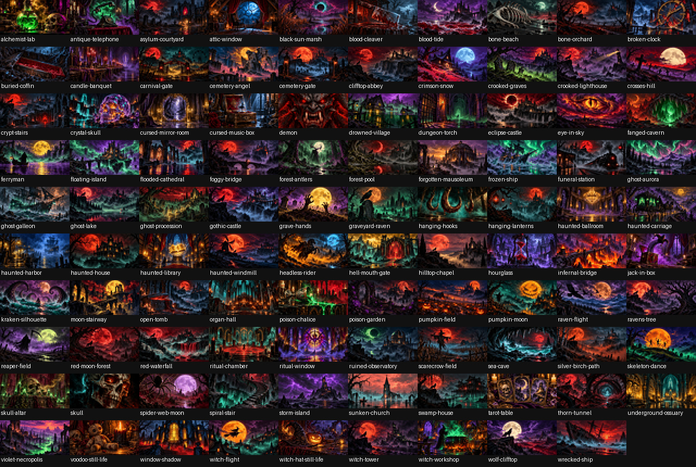

# Haunted Matrix

Atmospheric Halloween art for a **64×32 RGB LED matrix and Adafruit MatrixPortal M4**.



Haunted castles, foggy forests, ghost ships, ritual objects and other horror scenes
play in a shuffled slideshow. Pictures fade smoothly through black. During each
hold, a broad color family slowly dims and recovers as one coherent region.

- **99 bundled illustrations**, ready to use offline.
- 15-second holds, with two slow dim-and-recover cycles.
- Up to 70% dimming of a selected color region; unrelated colors stay unchanged.
- A single smooth fade out, brief black pause and fade in between pictures.
- Every picture plays once per shuffle round, without adjacent repeats.
- Optional support for an existing, user-supplied howling-wolf bitmap.
- No Wi-Fi credentials, accounts, API keys or external CircuitPython libraries.

The artwork includes adult horror imagery. All bundled illustrations were
AI-generated; [the prompts](ARTWORK-PROMPTS.md) and editing sources are included.

## Hardware and compatibility

The release was developed and hardware-tested with an Adafruit MatrixPortal M4,
a 64×32 HUB75 panel at 4 mm pitch, and **CircuitPython 7.0.0**. Use the panel's
appropriate power supply and a USB data cable for installation.

The display setup includes a `root_group`/`show()` compatibility fallback, but
other CircuitPython versions and MatrixPortal S3 hardware have not been tested.
See [Adafruit's MatrixPortal guide](https://learn.adafruit.com/adafruit-matrixportal-m4)
for hardware preparation and CircuitPython installation.

## Future work: CircuitPython upgrade

A firmware upgrade is deferred for now. The working, hardware-tested baseline
remains CircuitPython 7.0.0. At a later maintenance session, evaluate a newer
stable release (10.3.1 was considered on 2026-10-27), back up the board first,
and validate gallery loading, fades, color-region dimming and optional artwork
before documenting support. This is a future plan, not a compatibility claim.

## Install

1. Back up your current board files before replacing the startup program.
2. Download and extract **haunted-matrix-1.0.0-install.zip** from
   [Releases](https://github.com/yogitea/haunted-matrix/releases).
3. Connect the board and open its **CIRCUITPY** drive.
4. Copy `gallery.bin`, `ambience.py` and `transitions.py` from inside the extracted
   folder directly to the drive root. Copy `code.py` **last**.
5. Wait for copying to finish. The slideshow starts automatically; tap reset if
   needed. Eject the drive before disconnecting USB.

The drive should contain:

```text
CIRCUITPY/
├── code.py
├── ambience.py
├── transitions.py
└── gallery.bin
```

Other existing board files can remain. After installation, the normal power
supply is enough for standalone playback. Do not copy the source artwork or
individual BMPs to the board: the packed gallery avoids substantial filesystem
allocation overhead and is only **278,792 bytes**.

## Optional howling-wolf picture

The original wolf artwork from Adafruit's Moon Phase Clock project is **not
included or licensed by this repository**. The default installation works with
99 pictures and does not require it.

If you already have that file and the appropriate rights to use it, leave it on
your board and edit this setting near the top of `code.py`:

```python
WOLF_PATH = "/moon/splash-0.bmp"
```

The optional file must be an uncompressed **64×32, 24-bit RGB BMP**. It appears
first at startup, then participates in the shuffle, giving a 100-picture gallery.
It retains every original pixel and color. See [credits](CREDITS.md).

## Adjust the atmosphere

| Setting | File | Default |
| --- | --- | --- |
| Picture hold | `code.py`: `HOLD_SECONDS` | 15 seconds |
| Optional image | `code.py`: `WOLF_PATH` | `None` |
| Fade duration, excluding black hold | `transitions.py`: `DURATION` | 3 seconds |
| Black pause | `transitions.py`: `BLACK_HOLD` | 0.3 seconds |
| Region dimming | `ambience.py`: `MAX_DIM` | 179 / 256, about 70% |
| Breathing cycles per hold | `ambience.py`: `CYCLES` | 2 |

Keep `MAX_DIM` between 0 and 255. Similar hues are grouped smoothly and their
membership stays fixed during each hold. Very dark and neutral colors are
protected. The exact original palette is restored before the next fade.
Rendering speed affects the frame rate and adds a little time to each transition;
a complete 99-picture round takes roughly 30 minutes.

[Fade preview](transition-preview.gif) · [Picture catalogue](GALLERY.md)

## Development

The player itself needs only built-in CircuitPython modules. Desktop validation
uses Python 3.10 or newer and the standard library:

```sh
python tests/test_gallery.py
python tests/test_transitions.py
python tests/test_ambience.py
python tests/test_runtime.py
python tests/test_release.py
```

These check packed pixels and palettes, shuffle coverage, fade endpoints,
brightness bounds, coherent hue regions, interruption recovery, optional BMP
row ordering and the release archive. Desktop simulation does not replace a
visual check on real LEDs.

For editing artwork or regenerating previews:

```sh
python -m pip install -r requirements-dev.txt
python tools/prepare_artwork.py
python tests/test_transitions.py --preview
```

Editing sources are in `artwork/sources/`; the prepared 64×32 previews are in
`artwork/`. The preparation tool builds `gallery.bin` with an independent
256-color palette per picture. The runtime loads only one new picture at a time.

```sh
python tools/package_release.py
```

This produces a reproducible installation archive and checksum in `dist/`.
See [CONTRIBUTING.md](CONTRIBUTING.md) for the project layout and validation workflow.

## License

[MIT](LICENSE) for the code and bundled project assets, to the extent applicable
rights are held by the contributors. Third-party, user-supplied artwork is
excluded. See [CREDITS.md](CREDITS.md) for artwork provenance and hardware credits.
